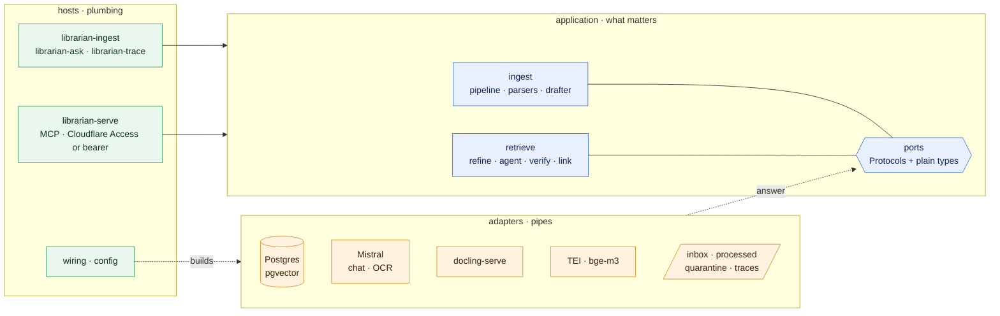
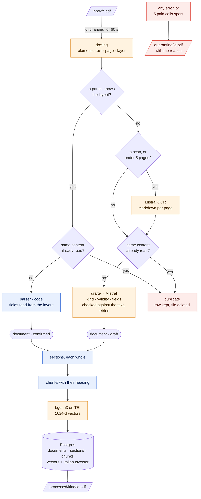
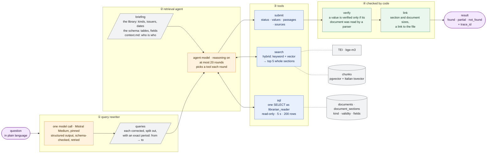
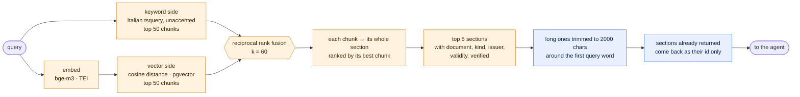
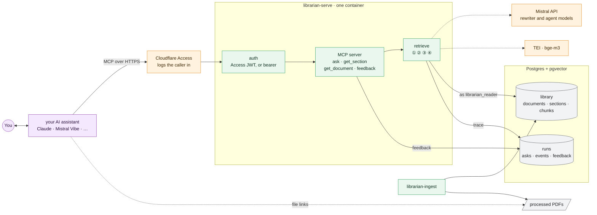
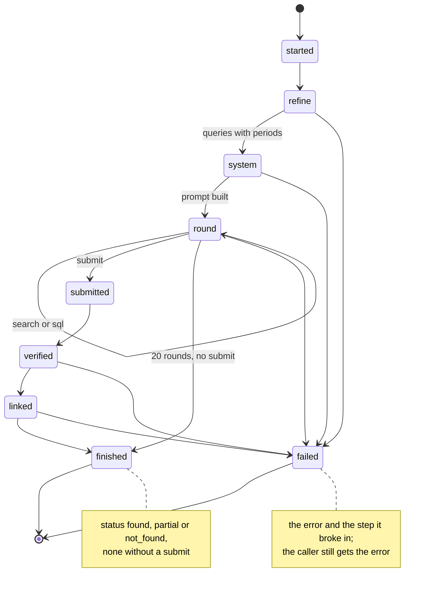

# Architecture

The code sits in three rooms, and the dependencies point one way.

- **The application** is what matters: the ingest flow, the agent and its prompts, the rules
  that decide what a document is and whether an answer is verified. It holds the logic and
  nothing else. When it needs the outside world (a model, the database, a folder) it calls a
  port: a `Protocol` it defines itself, with plain types going in and out.
- **The adapters** are the pipes. Each one answers a port for one technology (Postgres, Mistral,
  docling, the embedder, the filesystem) and knows nothing of why it is called. The Postgres
  models and migrations live here, and the repository is where the application's plain
  `Document` becomes rows.
- **The hosts** are the plumbing: the commands, the MCP server and its auth, the config, and the
  wiring that builds the adapters and hands them to the application.

To change what the Librarian does, read the application. To change how it talks to a service,
read that one adapter. To change how it starts or what it is configured with, read the hosts.
The evals sit outside the package: they measure it, they don't ship with it.

**The import rule.** The application imports nothing from the adapters or the hosts, and nothing
of the database (`sqlalchemy`, `psycopg`); a test enforces it. Adapters don't read the config:
a host hands it to them. The one exception is alembic's `env.py`, an entry point that lives with
the migrations and reads the database URL the way a host does.

## Ingest

Every file gets an `ingestions` row, read or not; it is written when the file starts, and
finished with how it ended. A read file gets a `documents` row (kind, validity, fields), its
`document_sections` (each section whole) and their `chunks` (the embedded pieces). If the
final write fails, the file goes back to the inbox. A document gets at most 5 paid model calls
(OCR, drafter and every retry); past them it goes to quarantine.

**Embeddings.** Each section is split into chunks that fit bge-m3's budget (8192 tokens, less a
margin), by paragraph, then sentence, comma and word only when a piece is still too long; most
sections fit in one chunk. Each chunk keeps its section's heading on top, and is embedded by
bge-m3 on Text Embeddings Inference into a 1024-dimension vector (pgvector). Postgres also keeps
each chunk's text as an Italian `tsvector`, accents stripped, for keyword search.

## Retrieve

This is the Librarian's job: a question in, an answer with its sources out. Three parts, each
with one role, then code that checks what they produced:

**① The query rewriter** is one call to its own model, with a schema the answer must fit. It
corrects the question's spelling, splits a question that is really several into queries, and
turns its time words ("quest'anno", "l'estate scorsa", "a maggio") into exact periods worked out
from today. An answer that doesn't fit the schema, or names a date that doesn't exist, is sent
back with the error. The model is pinned and measured by its own eval, so the agent's job is
finding, not interpreting.

**② The retrieval agent** is a second model, reasoning on, that digs until it can answer. It
starts briefed: the library's summary and the schema are in its prompt, so it spends no round
discovering them. Each round it picks a tool; on the last round `submit` is the only one left.

**③ The tools** split the work by what the documents hold:

- **sql** answers what the structured fields hold: totals, consumption, dates, counts across
  documents and years. It is safe by the database, not by inspecting the query: a role that can
  only read `documents` and `document_sections`, one statement per call, every call rolled back,
  the role's 5 s timeout, a 200-row cap enforced by Postgres, and our own clock that cancels a
  query past 8 s. A bad query comes back as the database's error, for the agent to read and fix.
- **search** finds what only the text says: a clause, a condition, a sentence to quote. It
  returns whole sections, with their document's kind, issuer, validity and status, so the agent
  reads the context, not a fragment.
- **submit** ends the dig with a status, the values, the passages that prove them, and their
  sources.

**④ Checked by code.** Verified comes from the document's status, never from the model: only a
value whose document was read by a parser is verified. Every value must name its source, each
source gets the sizes of what `get_section` and `get_document` return and a link to its file. A
question the documents don't answer ends `not_found`.

### Inside search

Both sides run in one SQL query:

Keyword search catches exact words and numbers; vector search catches the same meaning in other
words. The ranking is the adapter's SQL; trimming and the already-returned rule are the
application's, so the agent and the search eval see the same thing.

### Where it runs

The library is shared state: `librarian-ingest` writes it, an ask only reads it. What an ask
writes is its own record, the run and its events, to Postgres or to files
(`LIBRARIAN_TRACE_STORE`); feedback needs the Postgres one, since a rating points at its run.

### An ask's states

Each one is an event in its trace:

**Tracing.** Every ask leaves a trace under its correlation id: each state above, every round's
thinking, tool calls and results, with their times. It goes to files or Postgres in batches, and
never breaks an ask; `librarian-trace <id>` prints it.
